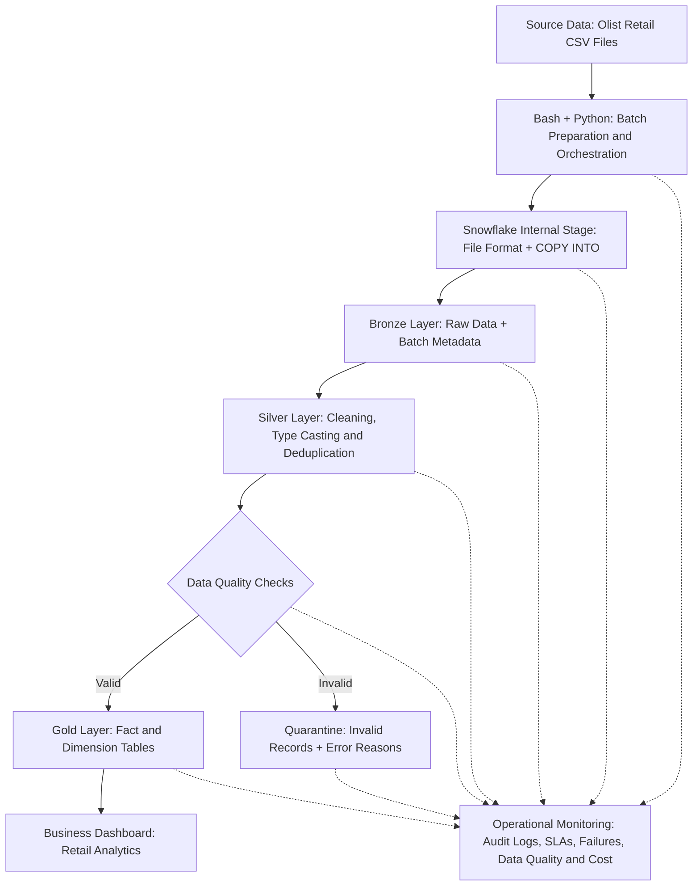

# Retail Data Platform Architecture

## End-to-End Data Flow

## Architecture Components

1. **Source Data:** Olist retail CSV files.
2. **Ingestion and Orchestration:** Bash and Python scripts prepare batches and orchestrate ingestion.
3. **Snowflake Stage:** Stores staged CSV files for loading using file formats and `COPY INTO`.
4. **Bronze Layer:** Preserves source data and batch metadata.
5. **Silver Layer:** Cleans data, standardizes data types, and removes duplicates.
6. **Data Quality Checks:** Validates transformed records and routes invalid records to quarantine.
7. **Quarantine:** Stores invalid records and their error reasons for investigation.
8. **Gold Layer:** Contains business-ready fact and dimension tables.
9. **Business Analytics:** Uses Gold-layer data for retail reporting and dashboards.
10. **Operational Monitoring:** Tracks audit logs, SLAs, failures, data quality, and costs across the pipeline.

## Data Flow Summary

Source CSV files are prepared into batches and uploaded to a Snowflake stage. The files are loaded into Bronze, transformed in Silver, and validated through data quality checks. Valid records feed the Gold data warehouse, while invalid records are routed to quarantine. Gold data supports retail analytics, and operational monitoring tracks pipeline execution and health.

